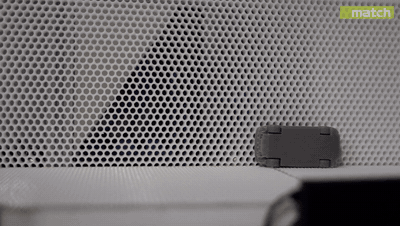

# BiBaZu

BiBaZu investigates image-based aerodynamic feeding of small parts at the Institute of Assembly Technology and Robotics (match), Leibniz University Hannover. The project combines camera-based pose recognition, simulation and controlled air pulses to orient workpieces for automated assembly.

**[Project website · demo, repositories and papers](https://match-bibazu.github.io/)**

[University project page](https://www.match.uni-hannover.de/en/research/current-projects/research-projects/projects/aerodynamic-part-feeding)

## Annotated feeder prototype

[View the full-size figure (PDF)](https://match-bibazu.github.io/assets/bibazu-feeder-annotated.pdf) · [More prototype photos](https://match-bibazu.github.io/#prototype)
